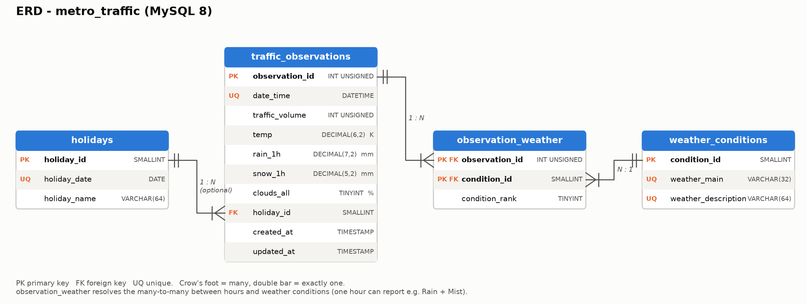
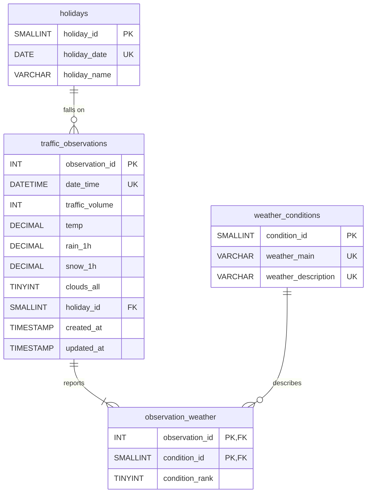

# Task 2 — Database design (MySQL + MongoDB)

Both databases hold the **raw** hourly observations (40,575 hours, Oct 2012 – Sep 2018) exactly as published, including the invalid sensor readings. Cleaning and imputation happen in [`src/preprocessing.py`](../src/preprocessing.py), so the databases stay the unmodified source of truth and the prediction script (Task 4) re-applies the same pipeline to whatever the API returns.

| File | Purpose |
|---|---|
| [`sql/schema.sql`](sql/schema.sql) | MySQL DDL: 4 tables, keys, constraints, indexes, a view |
| [`sql/erd.png`](sql/erd.png) | ERD (generated by `draw_erd.py`) |
| [`sql/queries.sql`](sql/queries.sql) | 6 analytical SQL queries |
| [`mongodb/validator.json`](mongodb/validator.json) | `$jsonSchema` validator for the collection |
| [`mongodb/sample_documents.json`](mongodb/sample_documents.json) | 4 representative documents exported after loading |
| [`mongodb/queries.js`](mongodb/queries.js) | 5 MongoDB queries (runnable in `mongosh`) |
| `load_mysql.py`, `load_mongodb.py` | Create schema/collection and load the CSV |
| `run_queries.py` | Runs every query and saves results to [`outputs/query_results/`](../outputs/query_results/) |

---

## 1. Relational design (MySQL 8)





**Design decisions**
* **`traffic_observations` is the time-series fact table.** One row per hour, enforced by `UNIQUE(date_time)`. The same index serves every date-range and latest-record query (`ORDER BY date_time DESC LIMIT 1` is an index scan).
* **Weather is many-to-many.** The source CSV repeats an hour once per weather condition (7,629 duplicate rows, up to 6 per hour). Instead of duplicating traffic values, `observation_weather` links each hour to 1..n rows of the `weather_conditions` lookup (38 distinct pairs). `condition_rank` keeps the source order, so rank 1 is the primary condition.
* **Holidays are a property of the date.** The CSV only labels the 00:00 hour. `holidays` stores one row per date (53 rows) and all 24 hours of that date reference it, which the analysis needs (EDA Q5).
* **Integrity:** FKs with `ON DELETE CASCADE` (deleting an hour removes its weather links), `ON DELETE SET NULL` for holidays, `CHECK` constraints on cloud cover and precipitation, and a case-sensitive collation for descriptions (the source has both *"Sky is Clear"* and *"sky is clear"*).
* `v_hourly_traffic` is a denormalised view (one row per hour, conditions joined with `|`) for ad-hoc analysis.

Row counts after `python database/load_mysql.py`: `holidays` 53, `weather_conditions` 38, `traffic_observations` 40,575, `observation_weather` 48,123.

## 2. MongoDB design

Collection **`metro_traffic.traffic_readings`**: one document per hour.

```json
{
  "_id": {"$oid": "6adf49388b5edaeb3c093fca"},
  "timestamp": {"$date": "2012-10-10T07:00:00Z"},
  "traffic_volume": 6793,
  "weather": {
    "temp_k": 281.25, "rain_1h_mm": 0.0, "snow_1h_mm": 0.0, "clouds_pct": 99,
    "conditions": [
      {"main": "Rain",    "description": "light rain"},
      {"main": "Drizzle", "description": "light intensity drizzle"}
    ]
  },
  "holiday": null,
  "calendar": {"year": 2012, "month": 10, "day": 10, "hour": 7, "day_of_week": 2, "is_weekend": false}
}
```

**Design decisions**
* **Embed, don't reference.** Weather conditions and the holiday name are always read together with the hour and never queried alone. Embedding gives a single-document read with no `$lookup`. The many-to-many that needs a junction table in SQL becomes a small embedded array.
* **Pre-computed `calendar` sub-document** (hour, weekday, weekend…) makes the most common time-series aggregations (hour-of-day profiles, weekday vs weekend) simple `$group`s that can use the `idx_dow_hour` index. The API rebuilds it on every write, so it can't drift.
* **Regular collection + unique index on `timestamp`** rather than a native time-series collection. Time-series collections don't support unique indexes. Here one-document-per-hour must be guaranteed, and documents must support full CRUD by id (Task 3).
* **Indexes:** `uq_timestamp` (unique, range and latest queries), `idx_dow_hour`, `idx_condition_main` (multikey on `weather.conditions.main`), and a partial index on `holiday` (only the ~1,200 observed holiday hours).
* **Schema validation** (`validator.json`, `validationLevel: strict`) enforces types, required fields, ranges (cloud cover 0–100, non-negative precipitation, hour 0–23) and at least one weather condition.

See [`mongodb/sample_documents.json`](mongodb/sample_documents.json) for four complete sample documents: the latest reading, a multi-condition hour, a Christmas Day hour and a snowy rush hour.

## 3. Queries and results

| # | SQL query ([`queries.sql`](sql/queries.sql)) | Technique |
|---|---|---|
| Q1 | Latest 5 observations with conditions + holiday | 3-table JOIN, `GROUP_CONCAT` |
| Q2 | Hour-of-day profile, weekday vs weekend | conditional aggregation |
| Q3 | Monthly summary for 2017 | date-range filter, `GROUP BY` month |
| Q4 | Holiday effect vs a normal day | CTE + scalar subquery |
| Q5 | Daily totals, 7-day moving average, day-over-day and week-over-week change | window functions `AVG() OVER`, `LAG()` |
| Q6 | Weekday rush-hour volume by weather | junction-table JOIN, `HAVING` |

| # | MongoDB query ([`queries.js`](mongodb/queries.js)) | Technique |
|---|---|---|
| M1 | Latest reading | `find().sort({timestamp:-1}).limit(1)` |
| M2 | Readings in a date range | `$gte` / `$lte` on `timestamp` |
| M3 | Weekday rush-hour volume by primary weather | `$match` → `$first` → `$group` |
| M4 | Daily totals + 7-day moving average | `$dateTrunc`, `$setWindowFields`, `$shift` |
| M5 | Holiday summary | `$group` on embedded field |

The full queries **with their outputs** are in
[`outputs/query_results/sql_query_results.md`](../outputs/query_results/sql_query_results.md) and
[`outputs/query_results/mongodb_query_results.md`](../outputs/query_results/mongodb_query_results.md).
Example (SQL Q6 / Mongo M3 give the same answer from the two designs):

| weather_main | rush_hours | avg_volume |
|---|---:|---:|
| Clouds | 1946 | 6059 |
| Clear | 1200 | 6043 |
| Rain | 580 | 5990 |
| **Snow** | 246 | **5421** |
